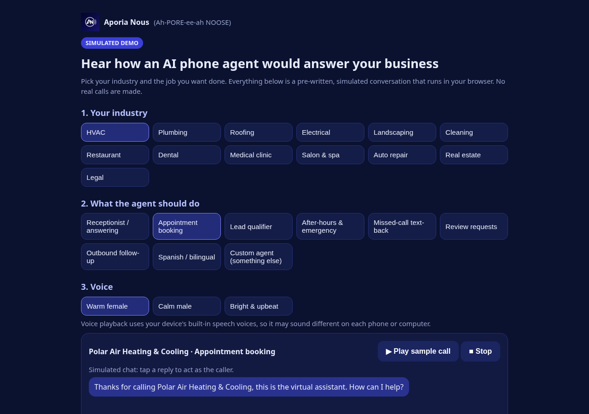
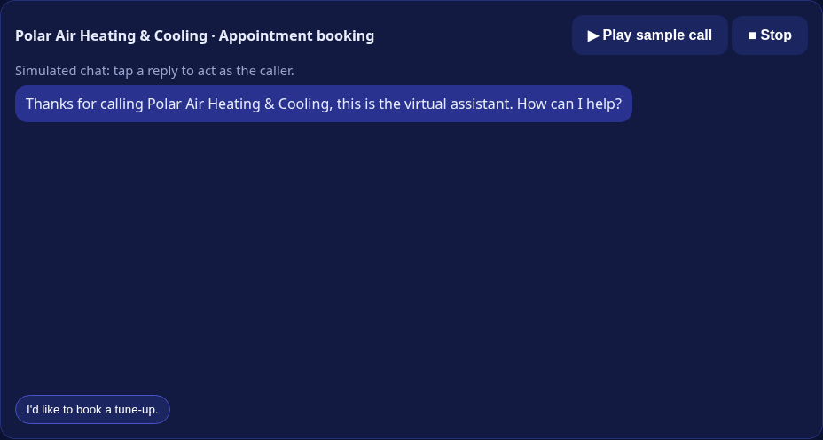
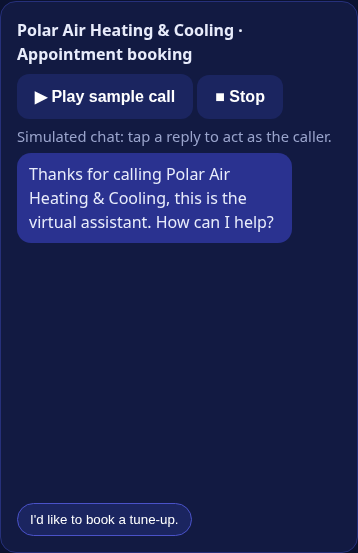

# AI Receptionist Demo App

Source for the live simulated demo at https://aporia-demo-app.vercel.app: a simulated AI receptionist chat, pricing and custom-request form, with a serverless lead endpoint that emails via Resend (key from env vars).

**Tech stack:** Vanilla JS/HTML/CSS, Vercel serverless functions, Resend API

> **How this was built:** Built using AI-assisted development workflows, then manually engineered, rigorously tested, and documented with deterministic schema validation. Demo data only: all names, numbers, and businesses are fictional.

## Screenshots

Built by DeAli Dillard ([Aporia Nous](https://github.com/Aporia-Nous)). Contact: demo@aporianous.com. MIT licensed.
